# Portafolio · Dayana Pañitrur

Portafolio web de Dayana Pañitrur, diseñadora con mención industrial que hoy expande su práctica hacia el diseño de interacción digital. Un azul eléctrico que se rompe en píxeles para dejar ver la naturaleza.

**Ver el sitio:** https://dayanapanitrur.github.io/examen-portafolio/<br>
**Repositorio:** https://github.com/dayanapanitrur/examen-portafolio

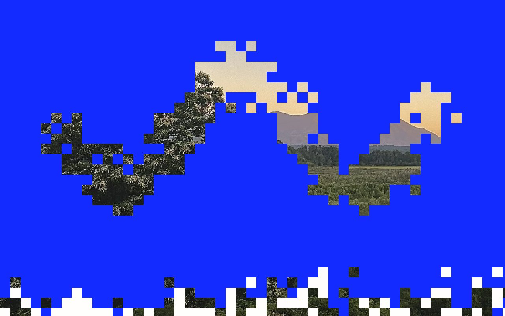

---

## Datos del examen

**Proyecto por:** Dayana Pañitrur

**Curso:** Dispositivos periféricos y plataformas para la interacción

**Impartido por:** Felipe Roa y Santiago Gaete

---

## Índice

1. [Concepto: azul eléctrico + naturaleza](#1-concepto-azul-eléctrico--naturaleza)
2. [Sistema gráfico](#2-sistema-gráfico)
3. [Interacción del fondo azul → naturaleza](#3-interacción-del-fondo-azul--naturaleza)
4. [La mano 3D cromada](#4-la-mano-3d-cromada)
5. [Estructura del sitio](#5-estructura-del-sitio)
6. [Cómo probarlo](#6-cómo-probarlo)
7. [Bitácora: conceptos, reflexión y herramientas](#bitácora)

---

## 1. Concepto: azul eléctrico + naturaleza

El sitio se construye sobre un contraste: un **azul eléctrico digital** (`#142BFF`), plano y saturado, que tapa una **fotografía de uno de mis lugares favoritos**, un paisaje de árboles, pasto seco y cerros al atardecer.

- **El azul es la pantalla:** lo digital, la interfaz, la capa que todo el tiempo está entre nosotros y lo que miramos.
- **La foto es lo natural:** lo que está debajo y que solo aparece cuando la pantalla se "rompe".
- **El píxel es el punto de encuentro:** el azul no se borra de forma suave, se quiebra en cuadrados del mismo tamaño que el cursor. Así lo digital y lo natural se mezclan en la misma grilla.

La paleta de la foto (verdes oscuros, ocres y cremas) es opuesta al azul. Por eso, cuando aparecen juntos, los dos se ven más intensos. Para los textos y fondos del resto del sitio elegí un **crema** cálido (en vez de blanco puro) y un **verde musgo** sacado de la misma naturaleza.

| Paleta del sitio | Paleta de la foto (colores dominantes) |
|---|---|
|  | 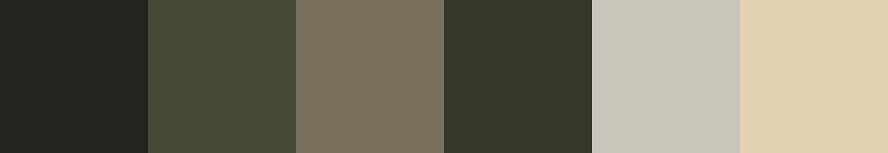 |

---

## 2. Sistema gráfico

### Tipografía

Uso solo **dos familias**, las dos gratuitas en Google Fonts (licencia SIL Open Font License 1.1).

| Tipografía | Dónde se usa | Tamaño (desktop / mobile) | Peso | Detalle |
|---|---|---|---|---|
| **Pixelify Sans** | Logo "dayana pañitrur" | 128 px (8rem) / 52 px (3.25rem) | Regular 400 | Inclinada −12° (`skewX(-12.02deg)`); "pañitrur" parte más adelante para formar una diagonal |
| **Pixelify Sans** | Títulos: nombre de cada proyecto, "¿interactuemos?", "contáctame! :)" | 56 a 72 px (3.5 a 4.5rem) | Regular 400 | Misma inclinación que el logo: es la "voz" del sitio |
| **Lexend** | Franjas que se deslizan (huinchas) | 24 px (1.5rem) / 16 px | Medium 500 | Espaciado de letras 6 % |
| **Lexend** | Menú | 20 px (1.25rem) / 16 px | Medium 500 | Punto indicador bajo la sección activa |
| **Lexend** | Textos y descripciones | 16 px (1rem) | Regular 400 | Interlineado 1.5, máximo ~70 letras por línea |
| **Lexend** | Botones | 16 px / 20 px (grande) | Medium 500 | Píldora con borde verde musgo |
| **Lexend** | Cursor (etiqueta y coordenadas) | 11 px (0.6875rem) | Medium 500 | Números de ancho fijo (`tabular-nums`) para que no "bailen" |

**¿Por qué estas dos?** Pixelify Sans es una tipografía hecha de píxeles: conversa directo con la grilla del fondo. Lexend fue diseñada para facilitar la lectura, así que equilibra el ruido visual del pixelado.

### Colores

Todos los colores viven como variables en `:root` (`css/estilos.css`). Puedes descargar cada muestra haciendo clic en ella.

| Muestra | Nombre | Hex | Variable CSS | Uso |
|---|---|---|---|---|
| <a href="img/readme/color-azul.png">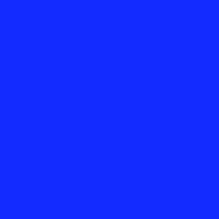</a> | Azul eléctrico | `#142BFF` | `--azul` | Portada, franjas, píxeles, títulos y footer |
| <a href="img/readme/color-crema.png">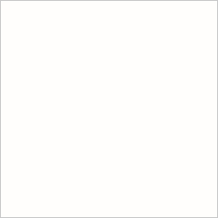</a> | Crema | `#FFFEFC` | `--crema` | Fondo general y texto sobre azul |
| <a href="img/readme/color-negro.png">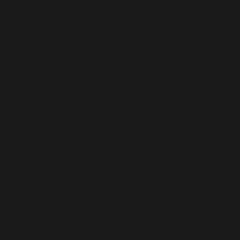</a> | Negro | `#1A1A1A` | `--negro` | Texto principal |
| <a href="img/readme/color-verde.png">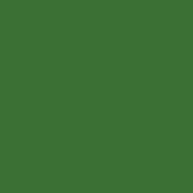</a> | Verde musgo | `#3B7034` | `--verde` | Cursor, botones y años (contraste 5,9:1 sobre crema) |
| <a href="img/readme/color-verde-oscuro.png">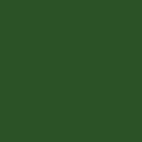</a> | Verde oscuro | `#2A5226` | `--verde-oscuro` | Botones presionados |
| <a href="img/readme/color-gris.png"></a> | Gris | `#73716B` | `--gris` | Textos de ayuda |
| <a href="img/readme/color-gris-claro.png"></a> | Gris claro | `#E5E5E5` | `--gris-claro` | Portadas de vinilo mientras cargan |
| <a href="img/readme/color-fondo-imagen.png"></a> | Fondo imagen | `#F4F3EF` | `--fondo-imagen` | Caja de imágenes mientras carga la foto |
| <a href="img/readme/color-blanco.png">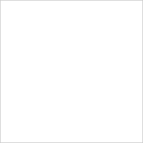</a> | Blanco | `#FFFFFF` | `--blanco` | Fondo de la ventana |

📥 **Descargar la paleta completa:** [img/readme/paleta.png](img/readme/paleta.png) · [paleta de la foto](img/readme/paleta-foto.png)

### Grilla y reglas

- **Solo flexbox**, sin grid ni frameworks.
- **Solo unidades `rem` y `%`** (1rem = 16 px).
- **Una sola media query** al final del CSS para mobile: `@media (max-width: 48rem)`.
- **Grilla invisible de píxeles:** el fondo, los bordes rotos y las fotos usan celdas de **26 × 26 px**, el mismo tamaño de la caja del cursor (16 px en pantallas táctiles).
- `position` solo en el header (fijo arriba con `sticky`).

### Movimiento

| Qué se mueve | Cuándo | Por qué |
|---|---|---|
| Píxeles del fondo | Al pasar el cursor y al bajar | Es la idea central: lo digital se rompe y aparece lo natural |
| Borde de la zona de quiebre | Siempre, titila suave | Invita a bajar a los proyectos |
| Franjas azules (huinchas) | Siempre, se deslizan hacia el lado | Nombran la sección como una cinta |
| Logo y nombres de proyectos | Solo al cargar (Text Scramble) | Las letras "cargan" como píxeles |
| Fotos de proyectos | Al aparecer en pantalla | Se destapan rompiendo una capa azul |
| Vinilos | Al pasar el cursor | Salen hacia el lado para mostrar la portada |

Si la persona tiene activado **"reducir movimiento"** en su sistema, las animaciones se frenan o se apagan.

---

## 3. Interacción del fondo azul → naturaleza

| En reposo | Con el cursor | Al bajar |
|---|---|---|
| 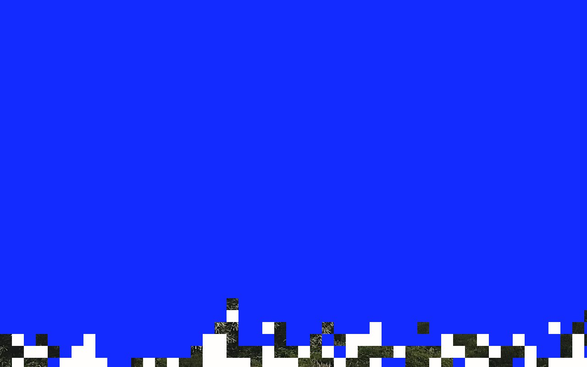 |  | 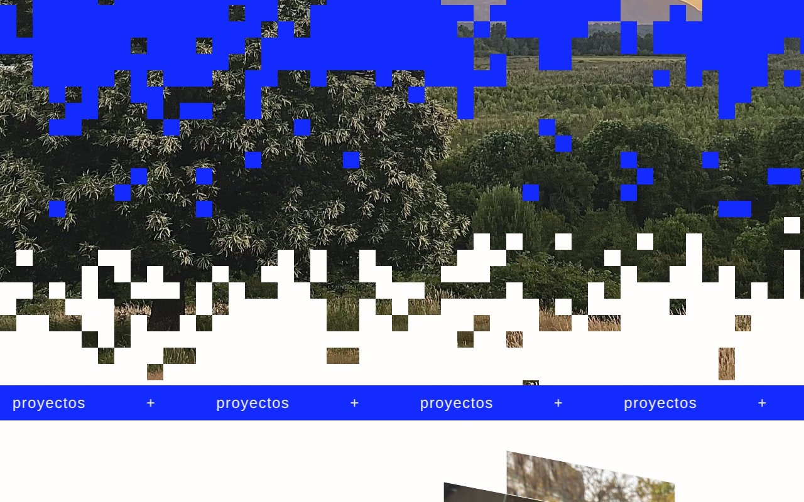 |

### Cómo funciona

1. **Un canvas detrás de todo:** detrás del header, la portada y la "zona de quiebre" hay un `<canvas class="fondo-pintura">`. JavaScript dibuja en él la foto y el azul.
2. **Grilla invisible:** el canvas se divide en celdas de 26 px. Cada celda puede estar en uno de tres estados: **azul**, **foto** o **vacía** (crema).
3. **El cursor abre celdas:** donde pasa el mouse se abre la celda de abajo y algunas vecinas al azar, para que el borde quede pixelado. Cada celda abierta "vive" entre 2,2 y 4 segundos y después vuelve al azul, cada una a su propio tiempo.
4. **Zona de quiebre:** bajo la portada, el azul se rompe en cuadrados hacia abajo, con pedacitos de foto. Algunas celdas cambian de vez en cuando, así el borde titila y se nota que hay algo más abajo.
5. **Scroll:** al bajar, el quiebre "sube" y se come la portada desde el borde hasta dejar la foto entera. En el teléfono funciona igual con el dedo.
6. **El cursor se adapta:** sobre azul o foto se pone crema, y sobre crema queda verde musgo, para verse siempre.

Fragmento de `js/main.js` que decide qué hay en cada celda según su profundidad:

```javascript
function forma(c, f, t, profundidad) {
  if (profundidad < -0.25) return 1;

  // Cada celda cambia de vez en cuando, a su propio ritmo (titileo del borde)
  const fija = ruido(c, f);
  const turno = quieto ? 0 : Math.floor(t / 150 / (5 + fija * 9) + fija * 13);
  const cambia = ruido(c * 1.7 + f * 3.1, turno);
  const columna = ruido(Math.floor(c / 2), 99);   // borde irregular, en bloques

  const v = profundidad + (columna - 0.5) * 0.3 + (cambia - 0.5) * 0.35;
  if (v < 0.3) return 1;                                 // azul
  if (v < 0.55 && ruido(c + 11, f + 7) < 0.5) return 2;  // foto
  if (v < 0.75 && cambia < 0.12) return 1;               // cuadraditos azules sueltos
  if (v < 0.9 && cambia > 0.93) return 2;                // pedacitos de foto sueltos
  return 0;                                              // vacía (crema)
}
```

Y el que abre celdas donde pasa el cursor:

```javascript
function abrir(x, y, ahora) {
  const c0 = Math.floor(x / CELDA);
  const f0 = Math.floor(y / CELDA);
  for (let df = -2; df <= 2; df++) {
    for (let dc = -2; dc <= 2; dc++) {
      // la celda del centro siempre se abre; las vecinas, a veces
      const lejos = Math.max(Math.abs(dc), Math.abs(df));
      const probabilidad = lejos === 0 ? 1 : lejos === 1 ? 0.55 : 0.15;
      if (Math.random() > probabilidad) continue;
      const vida = (VIDA_MIN + Math.random() * VIDA_EXTRA) * (lejos === 0 ? 1 : 0.7);
      reveladas.set(n, ahora + vida);   // la celda queda abierta hasta "ahora + vida"
    }
  }
}
```

El mismo sistema de celdas se repite en todo el sitio: en el **borde roto bajo cada franja azul**, en el **footer** (el azul sube rompiéndose) y en las **fotos de cada proyecto**, que aparecen destapando una capa azul.

---

## 4. La mano 3D cromada

<p align="center">
  <a href="img/readme/mano-3d.png">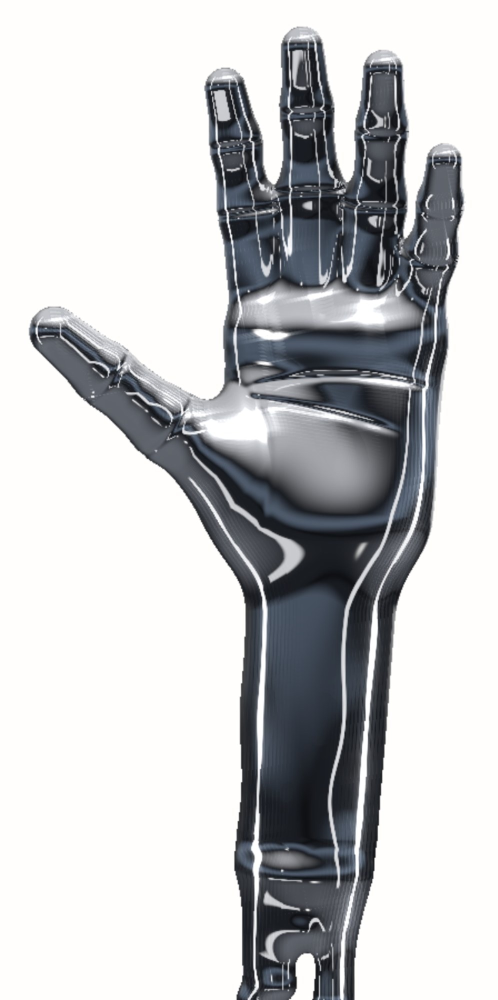</a>
</p>

📥 **Descargar la mano en alta resolución:** [PNG con fondo transparente](img/readme/mano-3d.png) · [JPG sobre crema](img/readme/mano-3d-crema.jpg)

En la página **"sobre mí"** aparece la pregunta **"¿interactuemos?"** junto a una mano de metal líquido. Para entrar a mi presentación hay que **mostrarle la mano abierta a la cámara**: la mano 3D responde y se deshace en píxeles.

### Cómo se hizo

La mano **no es un modelo 3D importado** (no hay archivo `.glb` ni `.obj`). Se dibuja completa con un **shader de WebGL2** usando una técnica llamada **raymarching** (`modelos-3d/mano-cromada.js`):

1. **Formas matemáticas:** cada parte es una figura simple descrita con una fórmula de distancia: la palma es una caja redondeada, cada falange es un cono redondeado y las almohadillas son elipsoides.
2. **Uniones suaves:** las partes se funden con una "unión suave" (`smin`). Por eso no se notan las uniones y se ve como metal líquido.
3. **Detalles:** se agregan surcos para las líneas de la palma y pliegues en los nudillos.
4. **Reflejos de cromo:** el metal no tiene color propio, refleja un "estudio" inventado: fondo oscuro, cielo claro arriba, tiras de luz verticales y un toque del crema de la página. También calcula un segundo rebote (lo que un dedo refleja de los otros dedos) y pequeños destellos de estrella.
5. **Respiración:** con JavaScript se calculan 20 articulaciones (5 dedos × 4 puntos) en cada cuadro. Los dedos se cierran y abren apenas, con un ritmo de ~6 segundos y un temblor distinto en cada dedo, para que no se vea mecánica.
6. **Dos pasos de dibujo:** primero la mano se dibuja en una textura a menor resolución (más liviano) y luego pasa a la pantalla con los destellos y, al final, con el efecto de disolución en píxeles y glitch.

Fragmento del shader: la palma y sus partes se funden con `smin`:

```glsl
float smin(float a, float b, float k) {
  float h = max(k - abs(a - b), 0.0) / k;
  return min(a, b) - h * h * k * 0.25;
}

/* --- palma: ahuecada, más angosta hacia la muñeca --- */
float ancho = mix(0.25, 0.30, smoothstep(-0.46, 0.25, pp.y));
float d = sdRoundBox(pp, vec3(ancho, 0.34, 0.012), 0.115);
d = smin(d, sdEllipsoid(q - vec3(-0.23, -0.17, 0.08), vec3(0.22, 0.29, 0.13)), 0.14); // base del pulgar
d = smin(d, sdEllipsoid(q - vec3(0.26, -0.13, 0.045), vec3(0.13, 0.29, 0.09)), 0.10);   // borde del meñique
```

### Cómo funciona la interacción

1. **Conectar:** el botón "conectar" pide permiso para usar la cámara y carga **MediaPipe Hand Landmarker** (`js/interactuemos.js`).
2. **Seguir la mano:** MediaPipe entrega 21 puntos de la mano real. La mano 3D se inclina siguiendo hacia dónde está tu mano.
3. **Reconocer la mano abierta:** se revisa que los 4 dedos estén estirados, que el pulgar esté separado y que los dedos estén abiertos en abanico.
4. **Mantenerla:** si la mano se mantiene abierta 0,65 segundos, la mano 3D se **deshace en píxeles** y aparece mi presentación (el CD) y el contacto.
5. **Sin cámara:** en el teléfono la mano late suave y basta con tocarla. En computador también hay un texto lateral que hace lo mismo sin usar la cámara.

```javascript
function manoAbierta(p) {
  const palma = distancia(p[0], p[9]);  // tamaño de referencia: muñeca → nudillo del medio
  if (palma < 0.05) return false;        // mano demasiado lejos

  const dedos = [[5, 6, 8], [9, 10, 12], [13, 14, 16], [17, 18, 20]]
    .filter(([b, m, t]) => dedoEstirado(p, b, m, t)).length;
  // pulgar: su punta se aleja del nudillo del índice
  const pulgar = distancia(p[4], p[5]) > palma * 0.55 && distancia(p[4], p[17]) > distancia(p[3], p[17]);
  // separación entre las puntas del índice y el meñique
  const abanico = distancia(p[8], p[20]) / palma > 0.75;

  return dedos === 4 && pulgar && abanico;
}
```

---

## 5. Estructura del sitio

```
examen-portafolio/
├── index.html              → inicio: portada en píxeles + pila de vinilos (proyectos)
├── sobre-mi.html           → ¿interactuemos? (mano 3D) + CD 3D + contacto
├── proyectos/              → una página por proyecto (7)
│   ├── multirealidades-sys.html   (T03)
│   ├── espectro.html              (T06)
│   ├── contrapresion.html         (T07)
│   └── banca-modular · sin-te · mimus-thenca · seq-01-y-seq-02
├── css/
│   ├── estilos.css         → sistema gráfico de todo el sitio
│   └── interactuemos.css   → sección de la mano 3D
├── js/
│   ├── main.js             → header, vinilos, fondo en píxeles, cursor, videos, Text Scramble
│   ├── interactuemos.js    → cámara + MediaPipe + mano
│   └── sobre-mi.js         → monta el CD 3D
├── modelos-3d/
│   ├── mano-cromada.js     → mano de metal líquido (shader WebGL2)
│   ├── cd-case.js          → caja de CD (three.js)
│   └── cd-case-con-foto.glb
├── img/                    → foto de la portada, portadas de proyectos e imágenes del README
├── videos/                 → videos de los proyectos del curso
└── README.md
```

---

## 6. Cómo probarlo

**En línea:** abre https://dayanapanitrur.github.io/examen-portafolio/ en el computador o en el teléfono.

**En tu computador:**
1. Descarga o clona el repositorio.
2. Ábrelo en Visual Studio Code.
3. Clic derecho en `index.html` → **Open with Live Server**.
4. Para probar la mano: entra a "sobre mí", presiona **conectar**, acepta la cámara y muéstrale la mano abierta.

> La cámara solo funciona desde `https://` o desde `localhost` (Live Server). Si abres el archivo con doble clic, la cámara no se activa.

---

## Bitácora

### Conceptos

Cuando empecé el curso tuve que autoexplicarme estos conceptos con analogías o ejemplificándolos como un organismo completo para entenderlos.

1. **HTML**: Corresponde a la estructura de la página web. Es donde se referencian todos los otros archivos que se utilizan, aquí no ocurre toda la complejidad, entonces cada vez que se necesite cambiar algo de los otros archivos no hay necesidad de cambiar también el html. Pueden haber más de 1 html en un solo sitio web, cuando hay solo un html a estos se les suele llamar single page.

Aquí un ejemplo de una pequeña parte de mi código, la cual es la base o lo mínimo que suele tener cualquier HTML:

```html
<!DOCTYPE html>
<html lang="es">
<head>
  <meta charset="UTF-8">
  <meta name="viewport" content="width=device-width, initial-scale=1.0">
  <meta name="description" content="Portafolio de Dayana Pañitrur, diseñadora con mención industrial.">
  <meta name="author" content="Dayana Pañitrur">
  <title>Dayana Pañitrur — Portafolio</title>

  <!-- Tipografías: Lexend (textos) y Pixelify Sans (logo) -->
  <link rel="preconnect" href="https://fonts.googleapis.com">
  <link rel="preconnect" href="https://fonts.gstatic.com" crossorigin>
  <link href="https://fonts.googleapis.com/css2?family=Lexend:wght@300;400;500;600;700&family=Pixelify+Sans:wght@400;500&display=swap" rel="stylesheet">

  <link rel="stylesheet" href="css/estilos.css">
</head>

```

En mi caso yo agregué un `head`, un `body` y un `footer`

---

2. **CSS:** El css contiene todo lo que es el sistema visual, los colores, cómo es la diagramación de los componentes, etc. Se conecta al sitio web a través del HTML que hace un "llamado":  ```<link rel="stylesheet" href="css/estilos.css">``` entonces cada vez que se quiere arreglar algo del estilo visual se cambia directamente en este archivo.

Aquí hay un ejemplo de parte de mi CSS, en el cuál le asigné algunas reglas para hacer que el diseño de la página fuese responsive.

```css
/* =====================================================================
   PORTAFOLIO · DAYANA PAÑITRUR
   ---------------------------------------------------------------------
   Reglas de este archivo:
   - Solo flexbox (sin grid ni frameworks).
   - Solo unidades rem y %. 1rem = 16 px (ej: 24 px = 1.5rem).
   - position solo en el header (sticky arriba).
   - Primero va el estilo de desktop y al final una sola media query
     para mobile.
   ===================================================================== */


/* =====================================================================
   1. VARIABLES (colores del UI Kit de Figma)
   ===================================================================== */

/* Guarda los colores del diseño con un nombre para reutilizarlos en todo el archivo */
:root {
  --azul: #142BFF;          /* color principal: portada, títulos y contacto */
  --crema: #FFFEFC;         /* fondo general y texto sobre azul */
  --negro: #1A1A1A;         /* texto principal */
  --verde: #3B7034;         /* verde musgo: cursor, botones y año (contraste 5.9 sobre crema) */
  --verde-oscuro: #2A5226;  /* botones cuando se presionan */
  --gris: #73716B;          /* textos de ayuda */
  --gris-claro: #E5E5E5;    /* fondo de las portadas de vinilo mientras cargan */
  --blanco: #FFFFFF;        /* fondo de la ventana y de las páginas de proyecto */
  --fondo-imagen: #F4F3EF;  /* fondo de la caja de imágenes mientras carga la foto */
}


/* --velo es cuánto se ve el fondo crema del header (0% = nada, 100% = entero).
   Se registra con @property para que el navegador pueda animarlo suave */
@property --velo {
  syntax: "<percentage>";
  inherits: false;
  initial-value: 0%;
}

/* --color-velo es el color de ese fondo: azul sobre la portada y crema
   en el resto. También se registra para que cambie de color suave */
@property --color-velo {
  syntax: "<color>";
  inherits: false;
  initial-value: #142BFF;
}
```
---

3. JavaScript

Diría que es el que tiene el funcionamiento más complejo porque aquí es donde ocurren la mayor parte de las interacciones, en este archivo sucede todo el comportamiento de la página, y la forma de integrarse en el sitio también es a través del llamado que hace el HTML `<script src="js/main.js"></script>`.

Aquí hay un ejemplo del carrusel de vinilos en mi portafolio.

```javascript
/* ---------------------------------------------------------------------
   2. CARRUSEL DE VINILOS
   La pila es fija: el orden no cambia y no se desliza.
   Lo único que se puede hacer es sacar un vinilo hacia el lado:
   - Desktop: al pasar el mouse sale (lo hace el CSS con :hover) y al
     sacar el mouse vuelve a su lugar. Un clic abre el proyecto.
   - Mobile: el primer toque saca el vinilo; un segundo toque en el mismo
     abre el proyecto. Tocar fuera de la pila lo guarda.
   El nombre del proyecto solo se ve mientras su vinilo está afuera.
   --------------------------------------------------------------------- */
const pila = document.querySelector('.pila');

if (pila) {
  const vinilos = [...pila.querySelectorAll('.vinilo')];

  // Centra la diagonal según la cantidad de vinilos y fija el lugar de cada uno
  pila.style.setProperty('--centro', (vinilos.length - 1) / 2);
  vinilos.forEach((vinilo, i) => vinilo.style.setProperty('--i', i));

  // Saca un vinilo (o ninguno, con null) y guarda los demás
  function sacar(vinilo) {
    vinilos.forEach((v) => v.classList.toggle('vinilo--afuera', v === vinilo));
  }

  if (esTactil) {
    vinilos.forEach((vinilo) => {
      vinilo.querySelector('a').addEventListener('click', (evento) => {
        if (!vinilo.classList.contains('vinilo--afuera')) {
          evento.preventDefault();
          sacar(vinilo);
        }
      });
    });

    // Tocar cualquier otra parte de la página guarda el vinilo
    document.addEventListener('click', (evento) => {
      if (!evento.target.closest('.vinilo')) sacar(null);
    });
  }
}


// Funciones que dicen qué hay en el fondo bajo un punto de la página
// (0 = crema, 1 = azul, 2 = foto). Las agregan las secciones 3 y 5 y las usa
// el cursor para ponerse crema sobre lo oscuro
const fondosDePixeles = [];
function fondoEnPunto(x, y) {
  for (const consultar of fondosDePixeles) {
    const fondo = consultar(x, y);
    if (fondo) return fondo;
  }
  return 0;
}
```

### Reflexión del semestre

Puedo concluir que estar en este curso fue una experiencia increíble, nunca pensé que podría haber hecho proyectos como los que hicimos, o por lo menos no tan pronto con los conocimientos que tenía. El curso me abrió la mente a explorar diversos conceptos y filosofías a las que nunca les había tomado atención.

Por otra parte me enseñó a utilizar bien el lenguaje y saber lo importante que es cuando queremos realizar proyectos donde nosotros dirigimos, aprendí a realizar mejores prompts para utilizar con IA y explorar todas sus posibilidades, a conocer programas y herramientas muy útiles que por seguro seguiré usando de aquí en adelante.

### Herramientas utilizadas

Herramientas, librerías y recursos que usé para hacer este portafolio.

| Herramienta | Para qué la usé | Autor / fuente | Licencia |
|---|---|---|---|
| HTML, CSS y JavaScript | Todo el sitio, sin frameworks (solo flexbox, rem y %) | Estándares web (W3C / WHATWG) | Abiertos |
| Visual Studio Code | Editor de código | Microsoft · [code.visualstudio.com](https://code.visualstudio.com) | Gratuito |
| Live Server (extensión de VS Code) | Ver los cambios en el navegador mientras programaba | Ritwick Dey · [marketplace.visualstudio.com](https://marketplace.visualstudio.com/items?itemName=ritwickdey.LiveServer) | MIT |
| Figma | Diseño del UI Kit (colores, tipografías, componentes) | Figma, Inc. · [figma.com](https://www.figma.com) | Gratuito (plan educación) |
| Git, GitHub y GitHub Pages | Control de versiones, repositorio y publicación del sitio | GitHub, Inc. · [pages.github.com](https://pages.github.com) | Gratuito |
| three.js 0.170.0 | CD 3D de "sobre mí" y mano cromada (`GLTFLoader`, `OrbitControls`, `RoomEnvironment`, `GLTFExporter`) | mrdoob y colaboradores · [threejs.org](https://threejs.org) | MIT |
| MediaPipe Tasks Vision 0.10.21 (Hand Landmarker) | Detectar la mano con la cámara en "¿interactuemos?" | Google · [ai.google.dev/edge/mediapipe](https://ai.google.dev/edge/mediapipe/solutions/vision/hand_landmarker) | Apache 2.0 |
| Text Scramble (componente) | Efecto de letras que se ordenan en el logo y en los nombres de proyectos, adaptado a JavaScript sin React | Julien Thibeaut (ibelick) · [Motion Primitives](https://motion-primitives.com/docs/text-scramble) | MIT |
| Simple Icons 16 | Íconos de GitHub e Instagram del footer | Colaboradores de Simple Icons · [simpleicons.org](https://simpleicons.org) | CC0 1.0 (las marcas son de sus dueños) |
| Lexend | Tipografía de textos, menú, botones y cursor | Bonnie Shaver-Troup, Thomas Jockin y colaboradores · [Google Fonts](https://fonts.google.com/specimen/Lexend) | SIL Open Font License 1.1 |
| Pixelify Sans | Tipografía del logo y de los títulos | Stefie Justprince · [Google Fonts](https://fonts.google.com/specimen/Pixelify+Sans) | SIL Open Font License 1.1 |
| jsDelivr | CDN desde donde se cargan three.js, MediaPipe y Simple Icons | [jsdelivr.com](https://www.jsdelivr.com) | Gratuito |
| FFmpeg | Comprimir los videos de los proyectos para la web | [ffmpeg.org](https://ffmpeg.org) | LGPL 2.1 / GPL |
| Claude (Anthropic) | Asistente de IA para programar y revisar el código (el detalle está en la reflexión) | [claude.ai](https://claude.ai) | Servicio |
| Fotografías y videos | Fondo de la portada, fotos de proyectos y videos de las experiencias | Dayana Pañitrur y sus equipos de cada proyecto | Propias |
| Modelo 3D del CD | Caja de CD con la foto y la presentación | Hecho con código (three.js) por Dayana Pañitrur | Propio |
