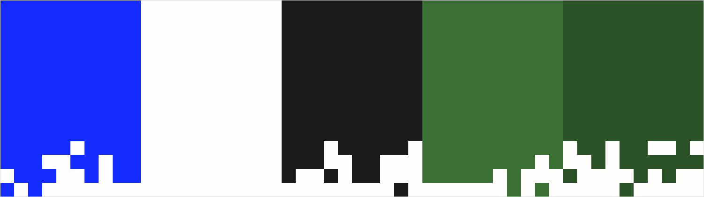

# Portafolio - Examen DPPID

**Proyecto por:** Dayana Pañitrur

**Curso:** Dispositivos periféricos y plataformas para la interacción

**Impartido por:** 

Felipe Roa

Santiago Gaete

---

## Bitácora

Este proyecto es mi portafolio web, en el cuál quise plasmar a través de lo visual lo que cotidianamente refleja mi mente.

# Portafolio · Dayana Pañitrur

Portafolio web de Dayana Pañitrur, diseñadora con mención industrial que hoy expande su práctica hacia el diseño de interacción digital. Un azul eléctrico que se rompe en píxeles para dejar ver la naturaleza.

**🌐 Ver el sitio:** https://dayanapanitrur.github.io/examen-portafolio/<br>
**📁 Repositorio:** https://github.com/dayanapanitrur/examen-portafolio

---

## Concepto

El sitio se construye sobre un contraste: un **azul eléctrico digital** (`#142BFF`), plano y saturado, que tapa una fotografía tomada por mí, del lugar donde vive mi abuelita, uno de mis lugares favoritos. Lo que quise representar en esta combinación fue el cruce que tuve entre mi mirada que por mucho tiempo estuvo enfocada en la naturaleza y este adentramiento al mundo digital. El pixel es el elemento que los conecta.

La paleta de la foto (verdes oscuros, ocres y cremas) es opuesta al azul. Por eso, cuando aparecen juntos, los dos se ven más intensos. Para los textos y fondos del resto del sitio elegí un **crema** cálido (en vez de blanco puro) y un **verde musgo** sacado de la misma imagen.
| Paleta del sitio | Paleta de la foto (colores dominantes) |
|---|---|
|  |  |

---

## Sistema gráfico

### Tipografía

Uso solo **dos familias**, las dos gratuitas en Google Fonts

### Conceptos

Cuando empecé el curso tuve que autoexplicarme estos conceptos con analogías o ejemplificándolos como un organismo completo para entenderlos.

1. **HTML**: Corresponde a la estructura de la página web. Es donde se referencian todos los otros archivos que se utilizan, aquí no ocurre toda la complejidad, entonces cada vez que se necesite cambiar algo de los otros archivos no hay necesidad de cambiar también el html. Pueden haber más de 1 html en un solo sitio web, cuando hay solo un html a estos se les suele llamar single page.

Aquí un ejemplo de una pequeña parte de mi código, la cual es la base o lo mínimo que suele tener cualquier HTML:

```cpp
<!DOCTYPE html>
<html lang="es">
<head>
  <meta charset="UTF-8">
  <meta name="viewport" content="width=device-width, initial-scale=1.0">
  <meta name="description" content="Portafolio de Dayana Pañitrur, diseñadora con mención industrial.">
  <meta name="author" content="Dayana Pañitrur">
  <title>Dayana Pañitrur — Portafolio</title>

  <!-- Tipografías: Lexend (textos) y Pixelify Sans (logo) -->
  <link rel="preconnect" href="https://fonts.googleapis.com">
  <link rel="preconnect" href="https://fonts.gstatic.com" crossorigin>
  <link href="https://fonts.googleapis.com/css2?family=Lexend:wght@300;400;500;600;700&family=Pixelify+Sans:wght@400;500&display=swap" rel="stylesheet">

  <link rel="stylesheet" href="css/estilos.css">
</head>

```

En mi caso yo agregué un `head`, un `body` y un `footer`

---

2. **CSS:** El css contiene todo lo que es el sistema visual, los colores, cómo es la diagramación de los componentes, etc. Se conecta al sitio web a través del HTML que hace un "llamado":  ```<link rel="stylesheet" href="css/estilos.css">``` entonces cada vez que se quiere arreglar algo del estilo visual se cambia directamente en este archivo.

Aquí hay un ejemplo de parte de mi CSS, en el cuál le asigné algunas reglas para hacer que el diseño de la página fuese responsive.

```cpp
/* =====================================================================
   PORTAFOLIO · DAYANA PAÑITRUR
   ---------------------------------------------------------------------
   Reglas de este archivo:
   - Solo flexbox (sin grid ni frameworks).
   - Solo unidades rem y %. 1rem = 16 px (ej: 24 px = 1.5rem).
   - position solo en el header (sticky arriba).
   - Primero va el estilo de desktop y al final una sola media query
     para mobile.
   ===================================================================== */


/* =====================================================================
   1. VARIABLES (colores del UI Kit de Figma)
   ===================================================================== */

/* Guarda los colores del diseño con un nombre para reutilizarlos en todo el archivo */
:root {
  --azul: #142BFF;          /* color principal: portada, títulos y contacto */
  --crema: #FFFEFC;         /* fondo general y texto sobre azul */
  --negro: #1A1A1A;         /* texto principal */
  --verde: #3B7034;         /* verde musgo: cursor, botones y año (contraste 5.9 sobre crema) */
  --verde-oscuro: #2A5226;  /* botones cuando se presionan */
  --gris: #73716B;          /* textos de ayuda */
  --gris-claro: #E5E5E5;    /* fondo de las portadas de vinilo mientras cargan */
  --blanco: #FFFFFF;        /* fondo de la ventana y de las páginas de proyecto */
  --fondo-imagen: #F4F3EF;  /* fondo de la caja de imágenes mientras carga la foto */
}


/* --velo es cuánto se ve el fondo crema del header (0% = nada, 100% = entero).
   Se registra con @property para que el navegador pueda animarlo suave */
@property --velo {
  syntax: "<percentage>";
  inherits: false;
  initial-value: 0%;
}

/* --color-velo es el color de ese fondo: azul sobre la portada y crema
   en el resto. También se registra para que cambie de color suave */
@property --color-velo {
  syntax: "<color>";
  inherits: false;
  initial-value: #142BFF;
}
```
---

3. JavaScript

Diría que es el que tiene el funcionamiento más complejo porque aquí es donde ocurren la mayor parte de las interacciones, en este archivo sucede todo el comportamiento de la página, y la forma de integrarse en el sitio también es a través del llamado que hace el HTML `<script src="js/main.js"></script>`.

Aquí hay un ejemplo del carrusel de vinilos en mi portafolio.

```cpp
/* ---------------------------------------------------------------------
   2. CARRUSEL DE VINILOS
   La pila es fija: el orden no cambia y no se desliza.
   Lo único que se puede hacer es sacar un vinilo hacia el lado:
   - Desktop: al pasar el mouse sale (lo hace el CSS con :hover) y al
     sacar el mouse vuelve a su lugar. Un clic abre el proyecto.
   - Mobile: el primer toque saca el vinilo; un segundo toque en el mismo
     abre el proyecto. Tocar fuera de la pila lo guarda.
   El nombre del proyecto solo se ve mientras su vinilo está afuera.
   --------------------------------------------------------------------- */
const pila = document.querySelector('.pila');

if (pila) {
  const vinilos = [...pila.querySelectorAll('.vinilo')];

  // Centra la diagonal según la cantidad de vinilos y fija el lugar de cada uno
  pila.style.setProperty('--centro', (vinilos.length - 1) / 2);
  vinilos.forEach((vinilo, i) => vinilo.style.setProperty('--i', i));

  // Saca un vinilo (o ninguno, con null) y guarda los demás
  function sacar(vinilo) {
    vinilos.forEach((v) => v.classList.toggle('vinilo--afuera', v === vinilo));
  }

  if (esTactil) {
    vinilos.forEach((vinilo) => {
      vinilo.querySelector('a').addEventListener('click', (evento) => {
        if (!vinilo.classList.contains('vinilo--afuera')) {
          evento.preventDefault();
          sacar(vinilo);
        }
      });
    });

    // Tocar cualquier otra parte de la página guarda el vinilo
    document.addEventListener('click', (evento) => {
      if (!evento.target.closest('.vinilo')) sacar(null);
    });
  }
}


// Funciones que dicen qué hay en el fondo bajo un punto de la página
// (0 = crema, 1 = azul, 2 = foto). Las agregan las secciones 3 y 5 y las usa
// el cursor para ponerse crema sobre lo oscuro
const fondosDePixeles = [];
function fondoEnPunto(x, y) {
  for (const consultar of fondosDePixeles) {
    const fondo = consultar(x, y);
    if (fondo) return fondo;
  }
  return 0;
}
```

### Reflexión del semestre

Puedo concluir que estar en este curso fue una experiencia increíble, nunca pensé que podría haber hecho proyectos como los que hicimos, o por lo menos no tan pronto con los conocimientos que tenía. El curso me abrió la mente a explorar diversos conceptos y filosofías a las que nunca les había tomado atención.

Por otra parte me enseñó a utilizar bien el lenguaje y saber lo importante que es cuando queremos realizar proyectos donde nosotros dirigimos, aprendí a realizar mejores prompts para utilizar con IA y explorar todas sus posibilidades, a conocer programas y herramientas muy útiles que por seguro seguiré usando de aquí en adelante.

### Herramientas utilizadas

